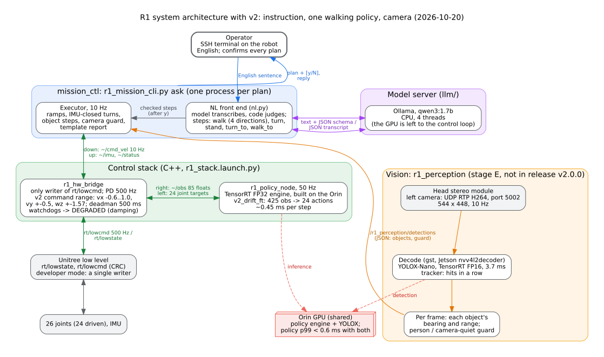
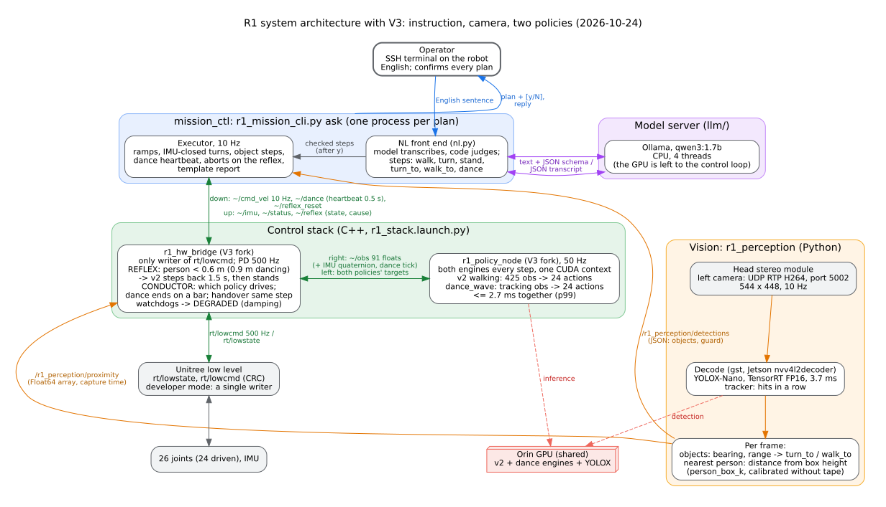

# LDRQ：让宇树 R1 人形机器人从仿真走到真机，并听懂英文指令

[](https://github.com/NAPPING-AI/LDRQ/actions/workflows/tests.yml)
[](LICENSE)

[English](README.md)

这个项目为**宇树 R1** 人形机器人做了四件事：

- 在 Isaac Lab 里训练行走策略；
- 部署到机器人自带的 Jetson Orin NX 上，不需要外接电脑；
- 在仿真和真机上用同一个变量量化 sim2real 差距；
- 加一层英文指令接口，由机器人本机运行的小语言模型解析指令。

项目先后有三个版本，各占一个分支。每个分支都有自己的 README、一个快速启动压缩包和一份上机指南。

<p align="center">
  <a href="docs/media/ldrq_pitch.mp4"></a>
  <br><em>点击观看 3 分钟介绍视频（<a href="docs/media/ldrq_pitch.mp4">docs/media/ldrq_pitch.mp4</a>）：训练、部署、sim2real 测量，以及真机上的英文指令</em>
</p>

## 三个版本

| 分支 | 版本 | 机器人能做什么 | 真机情况 | 快速启动包 | 上机指南 |
|---|---|---|---|---|---|
| **`main`**（本分支） | **v1** | 向前走（最快 1.0 m/s）、原地转向（最快 0.5 rad/s）；用英文下指令，模型跑在机器人上 | 发布为 v1.1.0；2026-10-02 至 10-20 在真机上使用 | [ldrq-v1-quickstart.tar.gz](quickstart/ldrq-v1-quickstart.tar.gz) | [ROBOT_GUIDE_zh.md](quickstart/ROBOT_GUIDE_zh.md) |
| [`v2`](https://github.com/NAPPING-AI/LDRQ/tree/v2) | **v2** | 在 v1 基础上能**后退**、**横移**，转向最快 1.57 rad/s，零指令时不再往前漂；模型改到 CPU 上；加入视觉节点（stage E） | 发布为 v2.0.0；2026-10-20 起在真机上使用 | `v2` 分支的 `quickstart/ldrq-v2-quickstart.tar.gz` | `v2` 分支的 `quickstart/ROBOT_GUIDE_zh.md` |
| [`v3`](https://github.com/NAPPING-AI/LDRQ/tree/v3) | **V3** | 在 v2 基础上加一个**跳舞**策略，与 v2 并行；加一个**近距反射**：人靠得太近时交给 v2 后退 | 2026-10-24 吊装、电机输出开，已在真机上跑通；脱吊装待做 | `v3` 分支的 `quickstart/ldrq-v3-quickstart.tar.gz` | `v3` 分支的 `quickstart/ROBOT_GUIDE_zh.md` |

三个版本的关系：
- **v2** 沿用 v1 的接口重训行走策略（425 维输入 → 24 个关节目标，50 Hz，增益相同）。策略以上的部分基本不变，只有两处改动：指令层读取 v2 更宽的速度范围，模型改到 CPU 上运行。
- **V3** 不改 v2 的行走策略。V3 的代码全部放在它分支的 `v3/` 目录下：硬件桥、策略节点、视觉节点和指令层各有一份分叉。在机器人上，V3 从 v2 的目录复制出一棵新的目录树再安装，v2 原样保留。

### 各版本的架构图

**v1**，即本分支的系统（2026-09-30）：


**v2**（2026-10-20）。相对 v1 的变化：新的策略文件和速度范围、模型改到 CPU、加入视觉节点。



**V3**（2026-10-24）。相对 v2 的变化：一个策略节点里跑两个策略，硬件桥里加了 conductor 和反射，指令层加了 `dance` 步骤。



v2 和 V3 的图复制自各自的分支，放在这里供对照（源文件：[system_architecture_v2.dot](docs/system_architecture_v2.dot)、[system_architecture_v3.dot](docs/system_architecture_v3.dot)）。

## v1（本分支）

### v1 是什么

v1 是第一个完整的系统，包括五部分：
- **策略** `week04_nohead`（训练记录 `2026-08-19_11-03-32_week04_nohead`）：在 Isaac Lab 里用 PPO 训练。
- **机器人端运行时**：策略在 Orin 上构建成 TensorRT FP32 引擎，先和 PyTorch 的结果对比（parity）才允许运行；C++/ROS 2 硬件桥是电机指令的唯一写入者。
- **指令层** `mission_ctl`：按时间或距离走、按角度转（用 IMU 闭环），每个计划都对照策略的训练范围检查。
- **英文指令**：例如 `ask "walk forward 1 meter, then turn left 90 degrees"`。小模型（qwen3:1.7b，通过 Ollama 运行，v1 中跑在 Orin 的 GPU 上）只负责转写句子；由代码检查计划，操作者确认后机器人才动。
- **一条命令换策略**（`policy_pack`）：v2 后来就是原样通过它安装的。

v1 于 2026-10-02 发布为 [v1.1.0](https://github.com/kedianwen/LDRQ/releases/tag/v1.1.0)，在真机上一直用到 2026-10-20 被 v2 取代。本分支是 v1.1.0 的代码，加上到 2026-10-14 为止的文档修正，不含任何 v2 的工作。

### 开发顺序

| 阶段 | 日期（2026） | 做了什么 | 通过的门槛 |
|---|---|---|---|
| W01 | 至 08-12 | 机器人进 Isaac Lab：URDF → USD，关节与质量检查，GPU 吞吐 | RK-7：一张 RTX 2080 Ti 够训练 |
| W02 | 08-14 | 平地速度跟踪任务，先学会站 | 仿真中站稳 |
| W03 | 08-15 | 奖励函数，第一个真正的步态；步态诊断工具 | 左右交替的步态 |
| W04 | 08-19 | 域随机化、5 帧观测历史、按硬件规格的执行器、头部移出动作：**得到 v1 策略** | PG-1：速度误差最大 0.037 m/s |
| W05 | 08-26 | 在 Orin 上 ONNX → TensorRT | parity 1.3e-5（门槛 1e-3） |
| W06 | 09-23 | C++/ROS 2 硬件桥、看门狗；第一次吊装行走 | 吊装下能走 |
| W07 | 09-24 | 真机行走与抗推；测量工具 | 真机被推后能恢复 |
| W08 | 09-28 | 测量 INT8 后放弃；脱吊装行走 | PG-2：脱吊装连续 ≥ 79.7 秒 |
| Stage A | 09-29 | `kp_scale` 扫描，仿真和真机画在同一个坐标轴上 | 仿真 0.80–2.00+，真机 1.10–1.50 |
| Stage B | 09-30 | `mission_ctl`：按时间走、按角度转、中止路径 | 10/10 次转向误差在 1.6° 内 |
| Stage C | 09-30 | 英文指令，模型在 Orin 本机运行 | 留出集 77/80，端到端 11/11 |
| Stage D | 10-02 | 一条命令换策略；发布 v1.1.0 | 3/3 个坏包被拒 |

每一步的详细经过，以及每一步发现的、指标里看不出来的问题：[docs/project_history.md](docs/project_history.md)。

### 重要参数

| 参数 | 取值 | 在哪里设置 |
|---|---|---|
| 观测 | 425 维 = 5 帧 × 85（角速度、重力方向、速度指令、26 个关节位置、26 个关节速度、上一步 24 个动作），不做归一化 | [deploy/interface/policy_interface.json](deploy/interface/policy_interface.json) |
| 动作 | 24 个关节位置目标；头部两个关节不由策略驱动 | 同上 |
| 控制频率 | 策略 50 Hz（仿真 dt 0.005 × decimation 4）；电机指令 500 Hz | `tasks/r1_flat/flat_env_cfg.py`、`bridge.yaml` |
| PD 增益（kp / kd） | 腿和腰 100 / 2，手臂和脚踝 40 / 2，手腕和头 20 / 1 | `assets/r1/r1.py`，每个关节单独设置 |
| 真机 `kp_scale` | **1.3**（1.10–1.50 范围内稳定；训练时为 1.0） | 启动参数 |
| 速度范围 | vx 0 → 1.0 m/s，vy 0，wz ±0.5 rad/s | `flat_env_cfg.py` 的 `COMMAND_RANGES_FINAL`；bundle 里的 `command_envelope.json` |
| 训练 | PPO，4096 个环境，3000 次迭代，每次每环境 24 步，学习率 1e-3，seed 42 | `tasks/r1_flat/agents/rsl_rl_ppo_cfg.py` |
| 硬件桥安全 | 默认输出关；速度指令 500 ms 失效（deadman）；关节目标超过 60 ms 算过期；控制频率低于 45 Hz → DEGRADED（阻尼） | `deploy/ros2_ws/src/r1_hw_bridge/config/bridge.yaml` |
| 引擎 | TensorRT FP32，关闭 TF32，在 Orin 上构建；parity `--tol 1e-3` | `policy_pack/install_bundle.sh` |
| 指令层 | 默认 0.4 m/s、0.4 rad/s；单步不少于 2 秒；每个计划最多 20 步、120 秒、30 米；转向误差 3° 以内，`turn_min_wz` 0.15 | `mission_ctl/config/mission.yaml` |
| 模型 | qwen3:1.7b（Q4_K_M），Ollama 0.34.4，监听 `127.0.0.1:11434`；全部层放 GPU（`llm_num_gpu: -1`） | `mission.yaml` 里的 `llm_*` |

### 中间文件

各阶段产生哪些文件，是否在 git 里：

| 文件 | 由谁生成 | 在 git 里吗 |
|---|---|---|
| `assets/r1/usd/R1.usd` | `scripts/convert_r1_urdf.py`，从 URDF 转换 | 否，随时可重新生成 |
| `logs/rsl_rl/r1_flat/<run>/`（checkpoint、TensorBoard、完整配置） | `scripts/train_r1.py` | 否（GB 级）；v1 那次训练的结果在 `models/` 和 `experiments/` |
| `experiments/<run>/`（配置、最终指标、pip freeze） | `scripts/archive_run.py` | 是，见 [experiments/runs.md](experiments/runs.md) |
| `models/week04_nohead/model_2999.pt` | 训练 checkpoint | 是 |
| `models/week04_nohead/policy.pt`、`policy.onnx` | `scripts/play_r1.py`（导出） | 是 |
| `models/week04_nohead/parity_fixture.bin` | 512 组输入及 PyTorch 的输出，每个引擎都要和它比对 | 是（`SHA256SUMS`） |
| `deploy/interface/policy_interface.json`、`actuator_gains.json` | `deploy/tools/dump_interface.py`、`dump_actuator_gains.py` | 是 |
| 策略包 `bundles/<run_id>/`（ONNX、接口、增益、速度范围、parity 夹具、来源记录、清单） | `policy_pack/make_bundle.py` | 否；打包进快速启动压缩包 |
| `deploy/artifacts/policy_fp32.plan` | `r1_build_engine`，**在机器人上**生成 | 否：引擎只能在构建它的机器上用 |
| `deploy/artifacts/installed.json` | `install_bundle.sh` 第 8 步，parity 通过后写入 | 否（机器人上） |
| `joint_map.hpp`、`bridge.yaml` 里的速度范围 | `install_bundle.sh` 第 4 步（`gen_configs.py`），从 bundle 生成 | v1 的版本已提交 |
| `~/orin_commissioning/*.log`、`ask_log.jsonl` | 机器人上的栈和 `ask` | 否；整理后的数据在 `docs/` |
| `docs/stageA_kp_sweep_*.json` | 扫描中每次录制的指标 | 是 |

### 快速启动

**不需要机器人**（任何装了 Python 3.8+ 的机器，不需要 GPU 和 ROS）：

```bash
git clone -b main https://github.com/NAPPING-AI/LDRQ.git && cd LDRQ
./run_tests.sh                                    # 不需要 GPU、ROS 或机器人，约 3 秒
python3 mission_ctl/r1_mission_cli.py capability  # 机器人自述能做什么
python3 mission_ctl/r1_mission_cli.py run "walk 3s@0.3; turn left 90" --dry-run   # 编译、检查并仿真一个计划
```

**在机器人上：** [quickstart/ldrq-v1-quickstart.tar.gz](quickstart/ldrq-v1-quickstart.tar.gz)（1.5 MB）包含 v1 在机器人上运行所需的全部内容：
- 硬件桥和策略节点的源码，在机器人上编译；
- `policy_pack`、`mission_ctl`、模型服务的脚本；
- v1 策略包；
- 自检脚本。

语言模型的运行时和权重约 1.8 GB，放不进 git，指南里写了从哪里获取。[quickstart/make_quickstart.sh](quickstart/make_quickstart.sh) 可以从已提交的代码重新生成这个压缩包。

### 上机指南

[quickstart/ROBOT_GUIDE_zh.md](quickstart/ROBOT_GUIDE_zh.md)（English：[quickstart/ROBOT_GUIDE.md](quickstart/ROBOT_GUIDE.md)）覆盖从把压缩包拷到机器人上，到下第一条英文指令的全过程。每一步都写了要检查什么、失败了怎么办。

想做训练或仿真：见英文 README 的 [*Reproducing*](README.md#reproducing) 一节。

## 结果一览（v1）

| 项目 | 结果 |
|---|---|
| 仿真速度跟踪（0.5–1.0 m/s） | 最大误差 **0.037 m/s**（门槛 0.15），零摔倒 |
| 真机 TensorRT 输出与 PyTorch 对比 | 512 组输入最大差 **1.3e-5**（门槛 1e-3） |
| Orin 上的策略推理（50 Hz 控制回路内） | **约 0.45 ms**，控制周期 20 ms |
| 不挂吊装连续行走 | **≥ 79.7 秒** |
| 能容忍的执行器刚度倍数 `kp_scale` | 仿真 **0.80–2.00+**，真机 **1.10–1.50**；差距来自躯干姿态，不是关节跟踪 |
| 真机闭环转向 | 10/10 次，按 IMU 读数误差都在 **1.6°** 以内 |
| 英文句子 → 经检查的计划（留出测试集） | Orin 上 **77/80**，中位耗时 0.65 秒；端到端 11 条指令全部正确 |
| 换策略 | **一条命令**、8 步检查；3 个坏包全部在改动任何文件之前被拒 |

## 亮点

- **仿真到真机的完整链路，全部在机器人本机运行。**
  - 训练：PPO + 非对称 actor-critic，五项域随机化，5 帧观测历史。
  - 部署：策略导出为 ONNX，在 Orin 上构建 TensorRT 引擎，用 parity 校验后，由 C++/ROS 2 硬件桥驱动。
- **用一张图量化 sim2real 差距。**
  - 仿真和真机跑同一串指令、用同一个稳定性判据，各自扫描关节刚度。
  - 结果：真机能容忍的范围最多只有仿真预测的三分之一；原因是躯干姿态，不是关节跟踪。
- **大部分真实缺陷都是"静默"的：** 链路报告成功，却给出看似合理的错误结果。报告里逐条列出了它们，例如：
  - TensorRT 的 `--fp32` 其实启用了 TF32；
  - 没切开发者模式时，厂家运控会和我们同时写电机指令，表现很像 sim2real 差距；
  - 奖励项 `feet_air_time_positive_biped` 的最优解是单腿站着不迈步。
- **"模型只转写、代码来判定"的指令层。**
  - 每个距离、时间、角度都必须在句子里明确说出来；
  - 超出训练范围的指令会被拒绝，并说明原因；
  - 回报内容由模板生成，不由模型生成。
- **可复现。**
  - 部署用的策略随仓库提供，无需重训；
  - CI 在每次推送时运行全部无 GPU 的检查；
  - 每个分支带一个快速启动压缩包和中英文上机指南；端侧 [release](https://github.com/kedianwen/LDRQ/releases) 附中文安装说明。

## 文档

| 文档 | 内容 |
|---|---|
| [docs/technical_report.md](docs/technical_report.md) | 技术报告：整个项目的完整叙述 |
| [docs/system_architecture.md](docs/system_architecture.md) | LLM 与运控的完整数据流、架构图和逻辑图 |
| [docs/stageA_kp_sweep.md](docs/stageA_kp_sweep.md) | 核心实验：`kp_scale` 稳定域，仿真与真机画在同一张图上 |
| [docs/project_history.md](docs/project_history.md) | 项目过程：周计划、验收门槛（PG/FR 编号的含义），以及每周的发现 |
| [quickstart/ROBOT_GUIDE_zh.md](quickstart/ROBOT_GUIDE_zh.md) | v1 上机指南 |

许可证：Apache-2.0。R1 的 URDF 和网格文件来自宇树，采用 BSD-3-Clause，详见 [NOTICE](NOTICE)。
